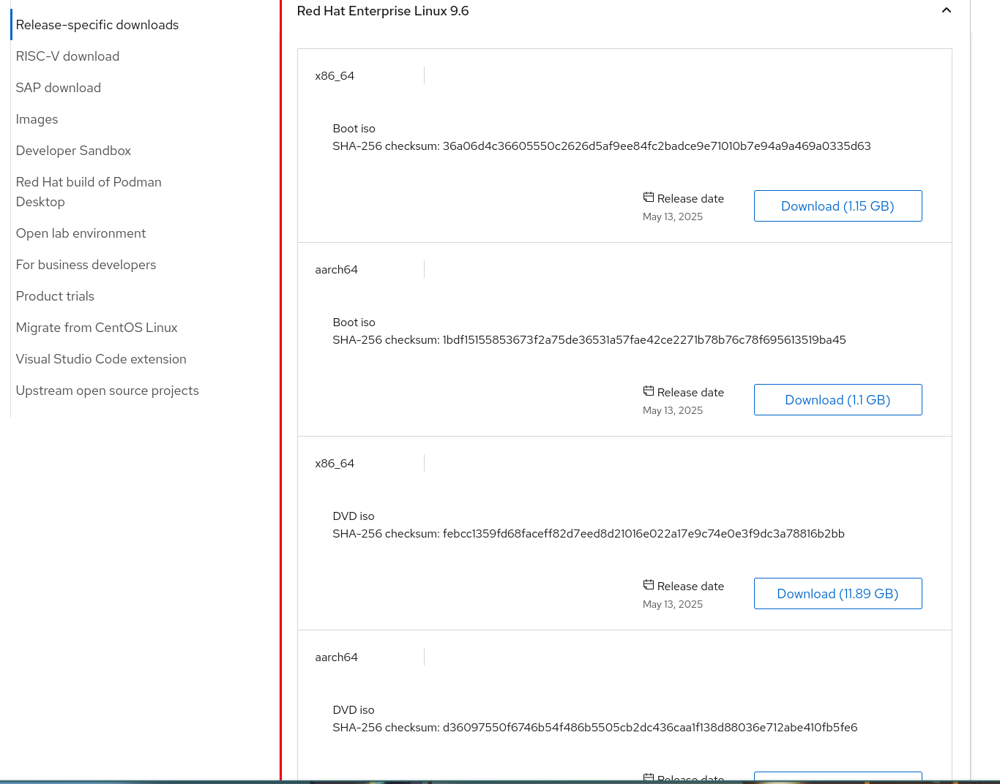
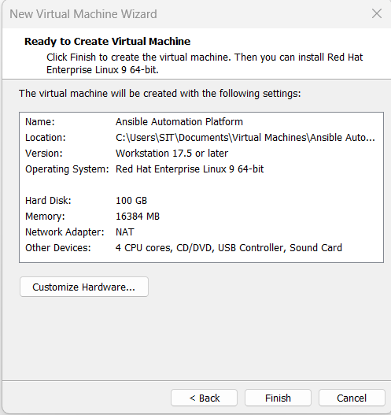
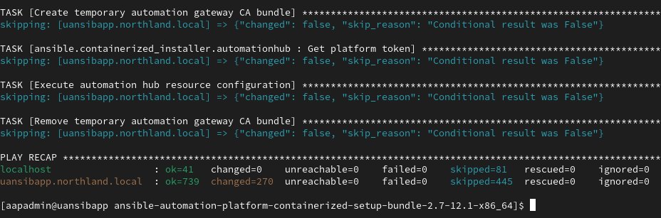
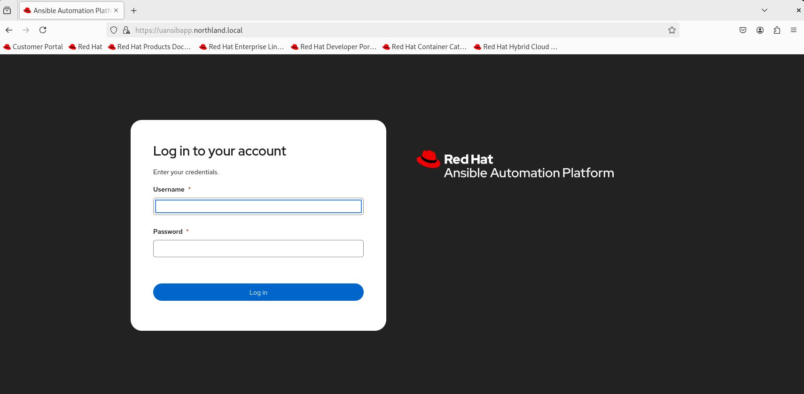
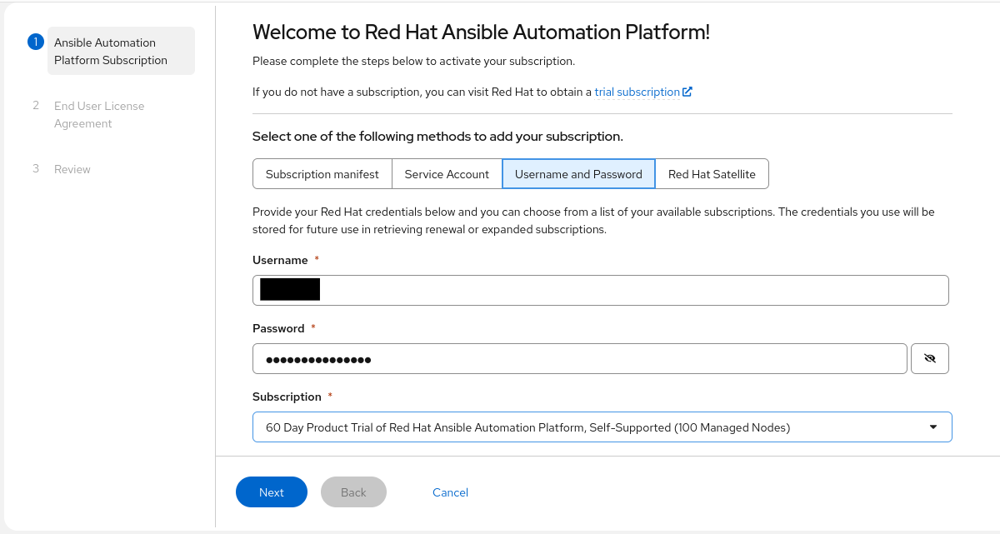
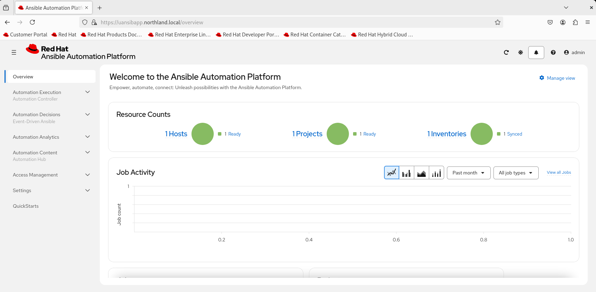

# Installing Ansible Automation Platform in a lab environment

Red Hat Ansible Automation Platform (AAP) can be installed on a single virtual machine in a lab environment. Having a local instance of the application can be useful when performing vulnerability assessment and tooling development.

Red Hat has published a list of system requirements on their website, which can be found [here](https://docs.redhat.com/en/documentation/red_hat_ansible_automation_platform/2.7/install-ref_cont_aap_system_requirements). Some of the key requirements are listed here

<table><thead><tr><th width="223">Requirement</th><th>Minimum Requirement</th></tr></thead><tbody><tr><td>RAM</td><td><ul><li>16 GB at minimum</li><li>32 GB for growth topology bundled installations (not relevant for this guide)</li></ul></td></tr><tr><td>CPU</td><td>4</td></tr><tr><td>Storage</td><td><ul><li>60 GB total storage at minimum</li><li>15 GB at minimum for installation directory, if using dedicated partition</li><li>10 GB at minimum for temporary directory (/tmp) for offline installations</li></ul></td></tr><tr><td>Operating System</td><td><ul><li>Red Hat Enterprise Linux 9.6 or later</li><li>Red Hat Enterprise Linux 10.0 or later</li></ul></td></tr><tr><td>Subscription Type</td><td><ul><li>Valid Red Hat Ansible Automation Platform subscription (trial available)</li><li>Valid Red Hat Enterprise Linux subscription (trial available)</li></ul></td></tr></tbody></table>

For this installation, we'll be performing a containerized installation of Ansible Automation Platform. Red Hat has provided instructions for installing the tool [here](https://docs.redhat.com/en/documentation/red_hat_ansible_automation_platform/2.7/install-proc_installing_containerized_aap), which this guide will reference.

You'll first need to register a Red Hat developer account, then download the [ISO file for RHEL](https://developers.redhat.com/products/rhel/download#downloadsbyrelease) and the [package for AAP](https://developers.redhat.com/products/ansible/download) from Red Hat's website. When downloading the ISO, it is recommended to download the full disk image instead of the boot disk, as it can simplify the initial installation steps.

<figure><figcaption></figcaption></figure>

Choose the appropriate DVD ISO download based on your architecture. Additionally, download the package for AAP like so. When downloading the software, ensure that "Containerized Setup Bundle" is downloaded and not "Containerized Setup".&#x20;

<figure><figcaption></figcaption></figure>

Once both files are downloaded, create a new virtual machine using the RHEL ISO with these settings and create a new non-root user with sudo permissions.

<figure><figcaption></figcaption></figure>


```bash
sudo useradd aapadmin
echo 'aapadmin ALL=(ALL) NOPASSWD: ALL' | sudo tee -a /etc/sudoers
```


After the initial installation is complete, the system will need to be registered with Red Hat's servers to access the repositories. Open a terminal and run the following commands, following the on-screen prompts as necessary.


```bash
sudo subscription-manager register
# A prompt should show up to log in with your RHEL account credentials
# Use the same credentials that you created at the start to download the files
sudo subscription-manager attach --auto
# If this errors with the message "Ignoring request to auto-attach", you can ignore it and move on
```


<figure><figcaption></figcaption></figure>

Once the system is registered, you can now update and install system packages from Red Hat's repositories. You'll need several additional packages, which can be installed with this command. There are also some additional configurations that need to be done in order to ensure that the automated installer works properly


```bash
sudo dnf install -y ansible-core wget git rsync

# Change the hostname of your system
# Not really mandatory, but its just personal preference
sudo hostnamectl set-hostname uansibapp.northland.local

# Add an entry to your system's /etc/hosts so that 
# the automated installer can resolve to the website
ip addr # Check the IP address of your system (e.g. 192.168.100.50)
# Change 'uansibapp.northland.local' with your preferred FQDN of the AAP installation
echo '192.168.100.50 uansibapp.northland.local' | sudo tee -a /etc/hosts
```


Copy the AAP archive onto the system, and unzip it using the command below. Enter the new directory created, and update the placeholder password. Run the automated installer using the built-in **`ansible-playbook`** command


```bash
tar xfvz ansible-automation-platform-containerized-setup-*.tar.gz
cd ansible-automation-platform-containerized-setup-*

# Replace "P@ssw0rd123" with your preferred password
# Ensure that special characters like '/' are properly escaped, otherwise it will break the command
sed -i 's/<set your own>/P@ssw0rd123/g' inventory-growth
# Change the hostname to match the FQDN created previously
sed -i 's/aap.example.org/uansibapp.northland.local/g' inventory-growth

# Run the automated installer as 'aapadmin' user
# You may choose to create a VM snapshot before running this command
# The installer is state-idempotic, so you can run it multiple times if the initial one fails
ansible-playbook -i inventory-growth -v ansible.containerized_installer.install
```


The automated installer will take anywhere from 30 minutes up to 2 hours to complete, depending on hardware settings. Once the installation is complete, the installer should return a final message indicating services' status before exiting

<figure><figcaption></figcaption></figure>

Access the portal using a web browser, and you'll be greeted with a login panel

<figure><figcaption></figcaption></figure>

Log in with the credentials set in **`inventory-growth`** and finish the initial setup. You'll then be directed to the dashboard, indicating that the installation and setup is successful

<figure><figcaption></figcaption></figure>

<figure><figcaption></figcaption></figure>
